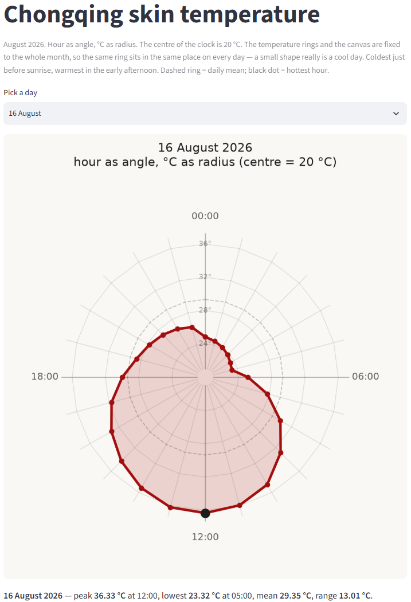
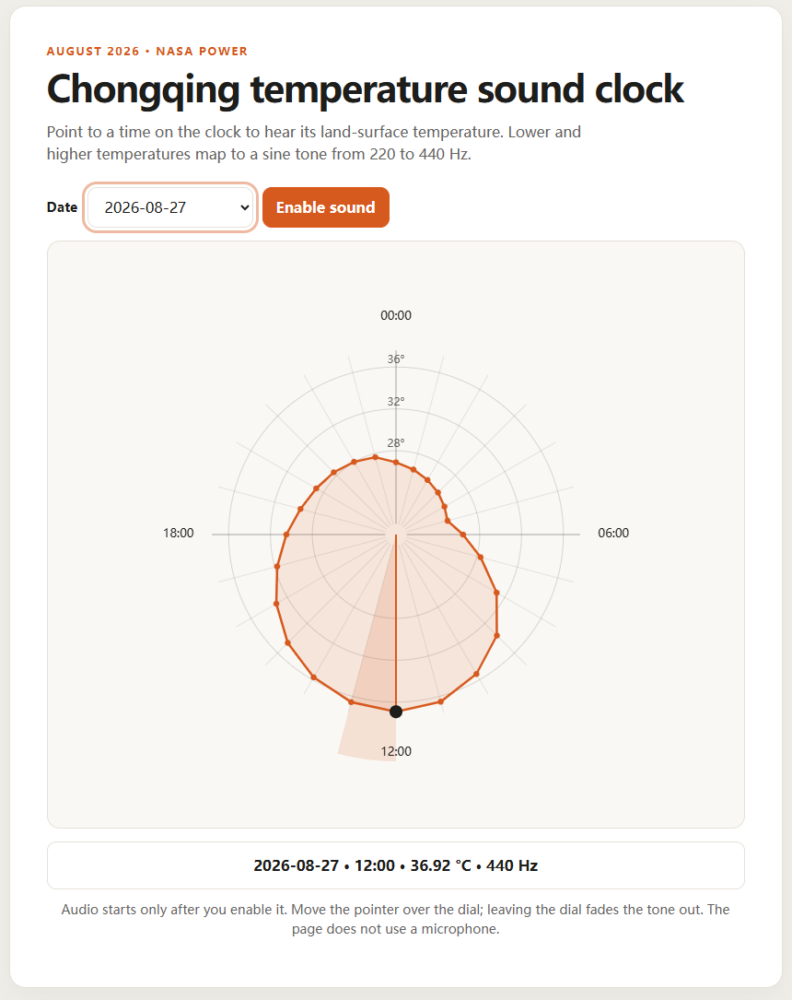

# Chongqing temperature clock: sound and interaction

This project explores hourly Earth skin temperature over Chongqing in August 2026, using NASA POWER data for one point in Yuzhong district. In the clock view, hour becomes angle and temperature becomes radius. This update builds on the existing charts with a synchronized sound animation and interactive ways to inspect the readings.

## Idea and audience

The clock shape makes the daily temperature cycle visible at a glance; the sound adds another way to notice how temperature changes over time. The project is intended for people curious about local climate data, including students and general audiences. The tone is an exploratory cue, not a calibrated representation of how temperature sounds.

## Screenshot

The Streamlit clock lets you compare days using the same temperature scale:

The browser sound clock lets you choose a date and point to an hour. Here, the selected time is 12:00 on 27 August: the readout shows 36.92 °C and its mapped pitch of 440 Hz. Click **Enable sound** to hear the tone.

## Main interactions and sound

- **Day picker:** In the Streamlit app, choose a date to redraw its clock shape and see the day's peak, low, mean, and range. The scale stays fixed to the full month for day-to-day comparison.
- **Browser sound clock:** Choose a date, enable sound, then point to a clock sector to see the hour, temperature, and pitch. The selected sector is highlighted and the tone fades when the pointer leaves the dial.
- **Clock animation:** The 24-second video sweeps through the hottest day, with one second per data hour. A sine tone follows the same continuous interpolation between hourly temperatures. Each day's minimum and maximum map linearly to 220 and 440 Hz.

[Play or download the clock animation with synchronized sound](out/ts-clock-hottest.mp4).

## Run it locally

The Python scripts require Python 3.10 or newer and [uv](https://docs.astral.sh/uv/). Run commands from the repository root.

Start the day-picker app:

    uv run --with streamlit --with matplotlib streamlit run app.py

Generate the hottest-day image and sound video:

    uv run ts_clock.py

Open the browser sound clock by serving the repository root:

    uv run --no-project python -m http.server 8000

Then visit <http://localhost:8000/web/clock.html>, click **Enable sound**, and select a date. Stop the local server with `Ctrl+C`. The CSV is included, so these views do not require fetching data from NASA.

There is no hosted online demo at present. The MP4 demonstrates the generated clock animation and sound; a separate screen recording of the browser interaction is not included.

## Known limitations

- The data represents one NASA POWER grid point, not street-level measurements or all of Chongqing, and covers August 2026 only.
- The pitch is a simple linear mapping of each day's temperature range to one octave; it is not calibrated to a musical or scientific sound scale.
- Browser sound requires Web Audio support and a user click to start. The browser page must be served over HTTP so it can load the local CSV.
- The browser clock is designed for pointer-based exploration; the Streamlit app provides the date-picker alternative.
